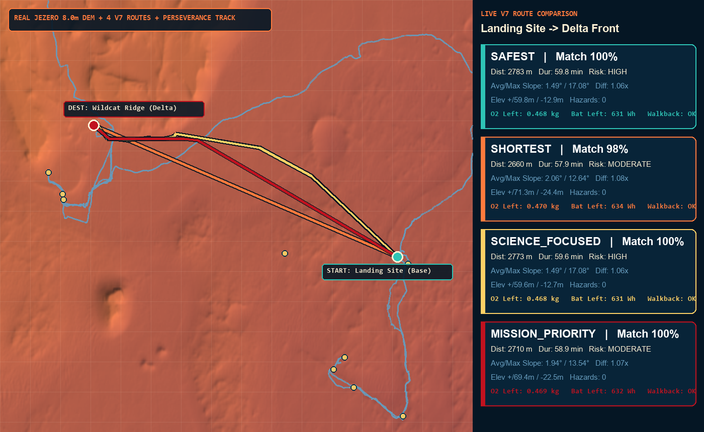
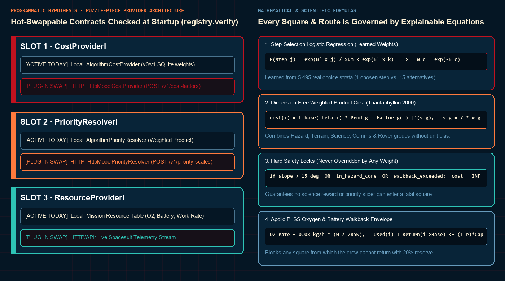

# RedGrid — Integrated Martian Mission-Planning Map & 3D EVA Simulator

**NASA Space Apps Challenge 2026 (Tripoli Local Event)**  
**Official Challenge Addressed:** *Interplanetary Survival Guide: Martian Map*  
**Team Members:** Jinan Arbas · Inaam Metlej · Oussama Hammoud · Fatima Sabbagh  

---

## Live Demo & Judge Links (GitHub Pages)

Once GitHub Pages is enabled on `/docs` (`main` branch), the following public links work immediately with **no sign-in required**:

- **Live Project Portal & Interactive Route Showcase:** `./` (`https://<your-username>.github.io/<your-repo>/`)
- **Interactive 5-Slide Judge Presentation (3D Theme):** `./slides/index.html` (`https://<your-username>.github.io/<your-repo>/slides/`)
- **Live Playable 3D Mars Descent & Surface Walk (`ARES/DESCENT`):** `./mars3d/index.html` (`https://<your-username>.github.io/<your-repo>/mars3d/`)
- **Downloadable PowerPoint Deck (`.pptx`):** [`docs/slides/RedGrid_NASA_SpaceApps_2026_5Slides.pptx`](docs/slides/RedGrid_NASA_SpaceApps_2026_5Slides.pptx)



---

## 1. Problem & Objective

Planning a human walk (EVA) on Mars today forces mission planners to cross-check **five separate tools by hand**—topographic DTMs, hazard maps, mineral/science targets, weather stations, and spacesuit oxygen/battery spreadsheets—where **one wrong turn** past the oxygen walkback limit is fatal.

**RedGrid** unifies 10+ open NASA PDS and USGS datasets over **Jezero Crater (`18.44°N, 77.45°E`)** onto a single co-registered **8.0 m × 8.0 m grid (`4,744,570` routable squares)** paired with a **first-person 3D Mars surface walk** (`three.js`). For any start and destination, RedGrid simultaneously computes four distinct routes (**`SAFEST`**, **`SHORTEST`**, **`SCIENCE_FOCUSED`**, and **`MISSION_PRIORITY`**) under one strict Apollo-style oxygen and battery walkback envelope.

---

## 2. Our Three Core Hypotheses (Scientific, Mathematical, Programmatic)

### A. Scientific Hypothesis — *Bridging Moon Humans + Mars Rovers*
Because **zero humans have ever walked on Mars** (only **Apollo 11–17** astronauts have walked on the Moon, and only **rovers** like *Perseverance* and *Curiosity* have driven on Mars), we hypothesize that crewed Martian EVA route selection can be factored into:
1. **Human physiological step-selection & metabolic oxygen expenditure** transferred from *Apollo 11–17* lunar EVA traverses and *Apollo PLSS* telemetry (`265–310 W` work rates $\rightarrow 0.07\text{–}0.09\text{ kg O}_2/\text{h}$), and
2. **Martian surface traversability** (loose aeolian ripples, crater rim scarps, bedrock roughness, and thermal inertia) learned from *Perseverance* and *Curiosity* traverses—without routing a walking astronaut like a wheeled rover.

### B. Mathematical Hypothesis — *Conditional Logit Step Selection + Weighted Product Routing*
1. **Step-Selection Conditional Logistic Regression (`CostProvider`):**  
   At every `10 m` step $s$ of a real traverse, we compare the **1 chosen step** ($j=1$) against **15 feasible alternative steps** ($j=2\dots16$) on the surrounding ring (`5,495` choice strata / `43,855` candidate steps):
   $$P(y_{s,j}=1 \mid X_s) = \frac{\exp(\beta^\top x_{s,j})}{\sum_{k=1}^{16}\exp(\beta^\top x_{s,k})}, \qquad w_c = e^{-\beta_c}$$
   where $w_c > 1$ indicates walkers avoid category $c$, and $w_c < 1$ indicates walkers prefer category $c$.
2. **Dimension-Free Weighted Product Model (`PriorityResolver` — Triantaphyllou 2000):**  
   To combine 6 category groups ($g \in \{\text{HAZARD}, \text{TERRAIN}, \text{SCIENCE}, \text{COMMS}, \text{UNCERTAINTY}, \text{ROVER\_PATH}\}$) with 7 user priority sliders $w_g$ without unit bias:
   $$\text{cost}(i) = t_{\text{base}}(\theta_i) \times \prod_{g} \left(F_g(i)\right)^{s_g}, \qquad s_g = 7\,w_g$$
3. **Hard Physics & Walkback Safety Locks ($\infty$-Cost Barriers):**  
   Learned weights are never allowed to override physical safety. Any cell $i$ with slope $\theta_i > 15^\circ$, inside a hazard core, or violating the round-trip walkback reserve is hard-blocked:
   $$R_{\text{used}}(\text{start}\to i) + R_{\text{walkback}}(i \to \text{nearest refill}) \le (1 - r_{\text{reserve}})\,R_{\text{initial}}$$

### C. Programmatic Hypothesis — *"Puzzle-Piece" Provider Architecture*
Every repository and AI/ML model slot is defined as a formal `@runtime_checkable Protocol` in [`backend/redgrid/interfaces.py`](backend/redgrid/interfaces.py) and verified at application startup by [`backend/redgrid/registry.py`](backend/redgrid/registry.py):
- **`CostProviderI`**: Switches seamlessly between `AlgorithmCostProvider` (local SQLite weights) and `HttpModelCostProvider` (`POST /v1/cost-factors` remote ML microservice).
- **`PriorityResolverI`**: Switches between `AlgorithmPriorityResolver` (Weighted Product Model) and `HttpModelPriorityResolver` (`POST /v1/priority-scales`).
- **`ResourceProviderI`**: Switches between mission-table inputs and live spacesuit telemetry streams.



---

## 3. Repository Structure

```text
redgrid-github-repo/
├── backend/                     # Python Flask API, Multi-Objective A* Routing Engine & SQLite DB
│   ├── redgrid/                 # Application factory, interfaces, providers, routing engine
│   ├── data/                    # Co-registered 8.0m Jezero rasters, GeoJSON vectors & MEDA CSV
│   ├── instance/redgrid.sqlite3 # Pre-built & populated SQLite database (ready to run)
│   ├── docs/                    # Backend algorithms, frontend integration & Postman collection
│   ├── tools/                   # Data preparation & cleaning pipeline (prepare_redgrid_data.py)
│   └── tests/                   # 120 pytest unit, math, contract, and integration tests
├── frontend/                    # React 19 + TanStack Start + Leaflet 2D + Three.js 3D Mode
│   ├── src/                     # Components, routes, API client, radar chart & unit tests
│   └── public/mars3d/           # Three.js 3D Mars Descent & Surface Walk
├── training_data/               # Cleaned CSV datasets for offline model training (5,495 strata)
│   └── README.md                # Training dataset schema & step-selection fitting guide
├── docs/                        # GitHub Pages live site (Portal + 5-Slide Deck + Live 3D Walk)
├── FUTURE_ROADMAP_AND_TODOS.md  # Detailed roadmap: from Version 0 (Physics) to Learned Models
├── DATA_SOURCES_AND_METHODOLOGY_DISCLAIMER.md
└── AI_USAGE_DISCLAIMER.md
```

---

## 4. How to Run the Full Stack Locally

### Step 1 — Start the Backend (`http://127.0.0.1:5000`)

```bash
cd backend
python -m venv .venv
# On Windows PowerShell:
.\.venv\Scripts\Activate.ps1
# On macOS/Linux:
# source .venv/bin/activate

pip install -r requirements.txt
flask --app redgrid run --host 127.0.0.1 --port 5000
```

*(Note: `backend/instance/redgrid.sqlite3` is already initialized and populated. To rebuild from scratch, run `flask --app redgrid init-db` and `flask --app redgrid load-data`.)*

### Step 2 — Start the Frontend (`http://localhost:8080`)

Open a second terminal:

```bash
cd frontend
npm install
npm run dev
```

Open **http://localhost:8080** in your browser.

### Step 3 — Run Backend & Frontend Automated Tests

```bash
# Backend test suite (120 tests):
cd backend
pytest -q

# Frontend unit + live API contract tests (48 tests):
cd frontend
npx vitest run
```

---

## 5. Current Model Status & Future Roadmap (`TODOs`)

To keep the prototype 100% transparent and reproducible for NASA Space Apps judges:
- **Active Today (`CostModel Version 0 — Published Physics + Hand-Set Baseline`):** The live application computes base walking energy, speed, and oxygen/battery consumption from peer-reviewed physics (`Minetti 2002`, `Tobler 1993`, `Soule & Goldman 1972`, `NASA BVAD`), combined with conservative engineering baseline weights in `redgrid.sqlite3`.
- **Prepared & Ready for Training ([`training_data/`](training_data/README.md)):** All `5,495` step-choice strata (`43,855` candidate steps across `819` Apollo 14 lunar human segments and `522` Perseverance Martian segments) are extracted, cleaned, and committed in [`training_data/`](training_data/), and the hot-swappable `HttpModelCostProvider` / `HttpModelPriorityResolver` slots are implemented and contract-tested.
- **Next Engineering Steps ([`FUTURE_ROADMAP_AND_TODOS.md`](FUTURE_ROADMAP_AND_TODOS.md)):**
  1. **`TODO 1` — Fit & Promote `CostModel Version 1`:** Run stratified Conditional Logistic Regression (`offset = ln(base_cost)`) on `training_data/jezero_step_choice_dataset.csv` and verify the held-out route overlap gate ($\Delta\text{overlap}_{20\text{m}} \ge +0.05$).
  2. **`TODO 2` — Deploy Continuous ML & AHP Microservices:** Plug a sub-meter HiRISE/THEMIS CNN/GBT cost predictor into `POST /v1/cost-factors` (`HttpModelCostProvider`) and an AHP/weather-adaptive resolver into `POST /v1/priority-scales` (`HttpModelPriorityResolver`).
  3. **`TODO 3` — $0.38\,g$ Martian Partial-Gravity Biomechanics:** Calibrate reduced-gravity Froude scaling (Farley & McMahon 1992) and pressurized suit joint-torque overhead.
  4. **`TODO 4` — Live Spacesuit Telemetry (`ResourceProviderI`):** Stream live PLSS/xEMU suit sensor readings (`source = 'SENSOR'`) and mobile rover refill positions.
  5. **`TODO 5` — Multi-Region Expansion:** Extend the automated GDAL/Rasterio pipeline to Arcadia Planitia, Mawrth Vallis, and Artemis III Lunar South Pole sites.
